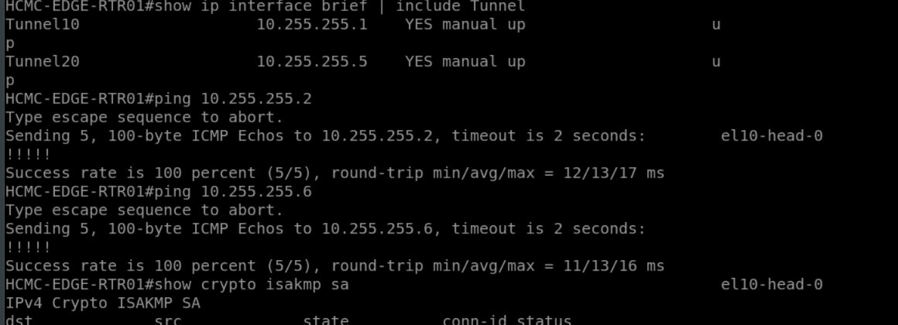
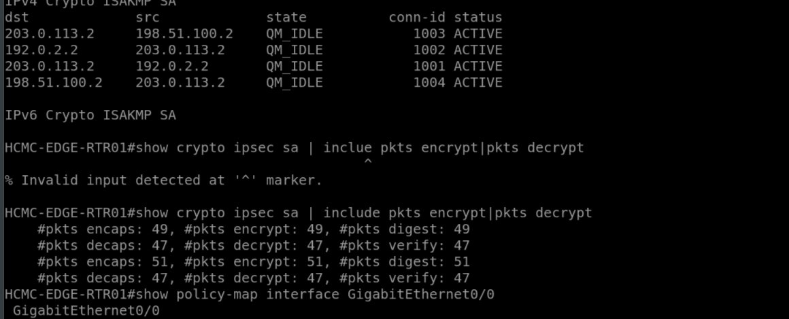

# CHƯƠNG 6: THIẾT KẾ MẠNG OVERLAY WAN & BẢO MẬT IPSEC (P3)

## 6.1. Giới thiệu và Yêu cầu Nghiệp vụ
Mạng diện rộng (WAN) của Tập đoàn Công nghệ TVI kết nối Trụ sở chính (HQ - TP. Hồ Chí Minh) với hai chi nhánh trọng điểm:
* **Chi nhánh Hà Nội (R&D Center)**: Đòi hỏi băng thông ổn định cho việc đồng bộ mã nguồn và gọi thoại bảo mật.
* **Chi nhánh Đà Nẵng (Logistics Center)**: Yêu cầu kết nối liên tục phục vụ điều phối kho vận và truy cập cơ sở dữ liệu thời gian thực.

Tất cả lưu lượng liên chi nhánh phải truyền thông qua hạ tầng mạng công cộng (Service Provider Cloud - `ISP-CLOUD-RTR01`). Do đó, hệ thống bắt buộc phải thiết lập kênh truyền ảo riêng biệt (**GRE Tunnel**) kết hợp cơ chế mã hóa cấp doanh nghiệp (**IPsec**) nhằm bảo vệ dữ liệu trước các nguy cơ tấn công nghe lén (Eavesdropping), giả mạo (Spoofing) và sửa đổi dữ liệu (Tampering).

---

## 6.2. Kiến trúc Đường hầm GRE over IPsec

### 6.2.1. Phân bổ Địa chỉ IP và Điểm đầu cuối Kênh truyền
Mô hình định tuyến sử dụng GRE over IPsec dạng Điểm - Điểm (Point-to-Point) kết nối từ HQ đến từng chi nhánh (hỗ trợ Dual-Stack OSPFv2 & OSPFv3 qua đường hầm):

| Kênh truyền | Thiết bị cục bộ | IP Giao diện Vật lý | IP Đầu cuối Tunnel | Thiết bị đầu xa | IP Giao diện Vật lý Đầu xa | IP Đầu cuối Tunnel Đầu xa |
| :--- | :--- | :--- | :--- | :--- | :--- | :--- |
| **Tunnel10** | `HCMC-EDGE-RTR01` | `203.0.113.2` (Gi0/0) | `10.255.255.1/30` | `HANOI-RND-RTR01` | `198.51.100.2` (Gi0/0) | `10.255.255.2/30` |
| **Tunnel20** | `HCMC-EDGE-RTR01` | `203.0.113.2` (Gi0/0) | `10.255.255.5/30` | `DANANG-LOG-RTR01` | `192.0.2.2` (Gi0/0) | `10.255.255.6/30` |

### 6.2.2. Tính toán MTU và MSS tránh Phân mảnh (Fragmentation)
Gói tin khi được bọc qua cả 2 tiêu đề (GRE: 24 bytes, IPsec ESP: ~50-56 bytes) sẽ vượt quá MTU chuẩn 1500 bytes của Ethernet nếu không được tối ưu.
* **IP MTU thiết lập:** `ip mtu 1400`
* **TCP MSS Clamping:** `ip tcp adjust-mss 1360` (đảm bảo phiên TCP SYN tự động thương lượng kích thước payload tối đa 1360 bytes, triệt tiêu hoàn toàn hiện tượng phân mảnh tại router biên).

---

## 6.3. Tiêu chuẩn Mã hóa và Bảo mật IPsec

### 6.3.1. IKE Phase 1 (ISAKMP Policy)
* **Thuật toán mã hóa:** AES-256 (Mã hóa khóa đối xứng cấp quân sự).
* **Thuật toán băm toàn vẹn (Hashing):** SHA-256 (HMAC).
* **Nhóm Diffie-Hellman (DH Group):** Group 14 (Độ dài khóa 2048-bit, an toàn chống tấn công brute-force).
* **Xác thực:** Pre-Shared Key (`TVI_Secret_Key2026!`).
* **Thời gian sống SA:** 86,400 giây (24 giờ, mặc định IOS).

### 6.3.2. IKE Phase 2 (IPsec Transform Set & IPsec Profile)
* **Transform Set:** `TVI-TS` (`esp-aes 256` kết hợp `esp-sha256-hmac`).
* **Chế độ bảo vệ:** **Transport Mode** (tiết kiệm 20 bytes IP header do GRE đã đóng gói địa chỉ IP gốc).
* **IPsec Profile:** `TVI-PROF`, gắn trực tiếp vào giao diện Tunnel bằng lệnh `tunnel protection ipsec profile TVI-PROF`.

---

## 6.4. Đoạn Cấu hình Mẫu trên `HCMC-EDGE-RTR01`

```cisco
! --- [P3] IPsec Phase 1: ISAKMP Policy ---
crypto isakmp policy 10
 encr aes 256
 hash sha256
 authentication pre-share
 group 14
!
crypto isakmp key TVI_Secret_Key2026! address 198.51.100.2
crypto isakmp key TVI_Secret_Key2026! address 192.0.2.2

! --- [P3] IPsec Phase 2: Transform Set & Profile ---
crypto ipsec transform-set TVI-TS esp-aes 256 esp-sha256-hmac
 mode transport
!
crypto ipsec profile TVI-PROF
 set transform-set TVI-TS
!

! --- [P3] GRE Tunnel Interfaces (Dual-Stack OSPFv2 & OSPFv3) ---
interface Tunnel10
 description GRE over IPsec to HANOI-RND-RTR01
 ip address 10.255.255.1 255.255.255.252
 ipv6 enable
 ip mtu 1400
 ip tcp adjust-mss 1360
 ip ospf network point-to-point
 ipv6 ospf 1 area 0
 ipv6 ospf network point-to-point
 tunnel source GigabitEthernet0/0
 tunnel destination 198.51.100.2
 tunnel protection ipsec profile TVI-PROF
 qos pre-classify
!
interface Tunnel20
 description GRE over IPsec to DANANG-LOG-RTR01
 ip address 10.255.255.5 255.255.255.252
 ipv6 enable
 ip mtu 1400
 ip tcp adjust-mss 1360
 ip ospf network point-to-point
 ipv6 ospf 1 area 0
 ipv6 ospf network point-to-point
 tunnel source GigabitEthernet0/0
 tunnel destination 192.0.2.2
 tunnel protection ipsec profile TVI-PROF
 qos pre-classify
!
ipv6 router ospf 1
 no passive-interface Tunnel10
 no passive-interface Tunnel20
!
```

---

## 6.5. Kiểm thử và Minh chứng Hoạt động (Test Case T7)

### 6.5.1. Kiểm tra trạng thái Tunnel và Thông tuyến VPN
Cả 2 giao diện Tunnel đều đạt trạng thái `up/up`. Thực hiện kiểm tra độ trễ và khả năng truyền tin xuyên hầm sang Hà Nội (`10.255.255.2`) và Đà Nẵng (`10.255.255.6`):


*Hình 6.1: Giao diện Tunnel10 và Tunnel20 UP/UP, tỷ lệ thành công đạt 100% (5/5) với độ trễ trung bình 13ms.*

### 6.5.2. Xác thực Đàm phán ISAKMP SA và Đếm gói Mã hóa IPsec SA
Kiểm tra bắt tay bảo mật Phase 1 (`show crypto isakmp sa`) và Phase 2 (`show crypto ipsec sa`):


*Hình 6.2: ISAKMP SA duy trì trạng thái QM_IDLE (Active) và bộ đếm #pkts encrypt / #pkts decrypt tăng lũy tiến chứng minh luồng dữ liệu được mã hóa thực tế.*

---

## 6.6. Kết luận Chương 6
Hệ thống mạng WAN Overlay bảo mật bằng GRE over IPsec đã hoạt động ổn định, đảm bảo toàn vẹn và bí mật thông tin truyền thông liên chi nhánh, tạo nền tảng vững chắc để triển khai các chính sách QoS và định tuyến nâng cao.
