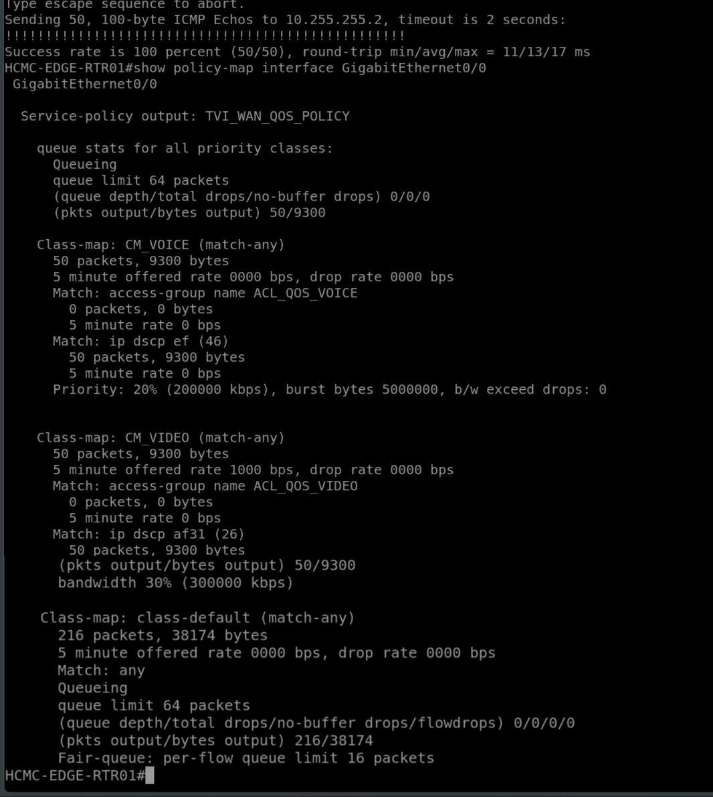

# CHƯƠNG 7: THIẾT KẾ CHẤT LƯỢNG DỊCH VỤ (QOS) & PHÂN TÍCH HÀNG ĐỢI (P3)

## 7.1. Đặt vấn đề và Mục tiêu QoS
Trong môi trường doanh nghiệp quy mô lớn, đường truyền WAN thường là điểm nghẽn cổ chai (Bottleneck) về băng thông so với mạng LAN nội bộ tốc độ cao. Khi xảy ra xung đột lưu lượng, nếu không có cơ chế điều phối:
* Gói tin thoại (VoIP) sẽ bị trễ (Latency > 150ms) và rung pha (Jitter > 30ms), dẫn đến gián đoạn cuộc gọi.
* Luồng hình ảnh (Video Conference) bị vỡ hình hoặc rớt khung hình (Packet loss).
* Các phiên truyền tải dữ liệu dung lượng lớn (Backup, File Transfer) chiếm hết dung lượng đường truyền.

**Mục tiêu của P3:** Triển khai mô hình dịch vụ phân biệt (**DiffServ**) sử dụng công cụ cấu hình mô-đun **MQC (Modular QoS CLI)** nhằm phân loại, đánh dấu và điều phối hàng đợi thông minh tại cổng ra WAN `GigabitEthernet0/0`.

---

## 7.2. Kiến trúc DiffServ MQC 3 Cấp

Chính sách QoS bao gồm 3 thành phần cốt lõi:

```
[Phân loại (Class-Map)]  --->  [Định chính sách (Policy-Map)]  --->  [Gán giao diện (Service-Policy)]
- CM_VOICE (ACL / DSCP EF)     - Priority 20% (LLQ)                   - GigabitEthernet0/0 (egress)
- CM_VIDEO (ACL / DSCP AF31)   - Bandwidth 30% (CBWFQ)
- class-default                - Fair-queue (WFQ)
```

### 7.2.1. Phân bổ Băng thông và Hàng đợi chi tiết

| Nhóm lưu lượng (Class) | Tiêu chí nhận diện (Match Criteria) | Giá trị DSCP | Cơ chế Hàng đợi (Queuing) | Tỷ lệ Băng thông | Giới hạn hàng đợi (Queue Limit) |
| :--- | :--- | :--- | :--- | :--- | :--- |
| **Voice (Thoại)** | ACL `ACL_QOS_VOICE` hoặc DSCP `ef` (46) | **EF (46)** | **LLQ (Low Latency Queuing)** | **20%** (200 Mbps) | 64 packets |
| **Video (Hội nghị)** | ACL `ACL_QOS_VIDEO` hoặc DSCP `af31` (26) | **AF31 (26)** | **CBWFQ (Class-Based WFQ)** | **30%** (300 Mbps) | 64 packets |
| **Class-Default (Dữ liệu)** | Mọi lưu lượng còn lại (`match any`) | Best Effort | **Fair-Queue (WFQ)** | **50%** (Dung lượng dư) | 64 packets (Per-flow 16 pkts) |

### 7.2.2. Tính năng `qos pre-classify` trên Đường hầm GRE
Khi gói tin đi vào giao diện Tunnel, IP header gốc (chứa giá trị DSCP) sẽ bị bao bọc bởi tiêu đề GRE và IPsec ESP. Nếu áp dụng QoS tại cổng vật lý `Gi0/0`, router thông thường sẽ không thể "nhìn thấy" thông tin DSCP bên trong. 
* **Giải pháp kỹ thuật:** Kích hoạt lệnh **`qos pre-classify`** trên cả 2 giao diện `Tunnel10` và `Tunnel20`. Router sẽ lưu trữ bản sao nhãn ToS/DSCP trước khi đóng gói, cho phép Policy-map tại cổng WAN vật lý phân loại gói tin chính xác 100%.

---

## 7.3. Đoạn Cấu hình MQC trên `HCMC-EDGE-RTR01`

```cisco
! --- [P3] BƯỚC 1: ACCESS-LIST PHÂN LOẠI LƯU LƯỢNG ---
ip access-list extended ACL_QOS_VOICE
 permit udp any any range 16384 32767
 permit tcp any any eq 5060
 permit udp any any eq 5060
 exit

ip access-list extended ACL_QOS_VIDEO
 permit tcp any any range 50000 50050
 permit udp any any range 50000 50050
 exit

! --- [P3] BƯỚC 2: CLASS-MAP (MQC) ---
class-map match-any CM_VOICE
 match access-group name ACL_QOS_VOICE
 match ip dscp ef
 exit

class-map match-any CM_VIDEO
 match access-group name ACL_QOS_VIDEO
 match ip dscp af31
 exit

! --- [P3] BƯỚC 3: POLICY-MAP ĐIỀU PHỐI HÀNG ĐỢI ---
policy-map TVI_WAN_QOS_POLICY
 class CM_VOICE
  priority percent 20
  exit
 class CM_VIDEO
  bandwidth percent 30
  exit
 class class-default
  fair-queue
  exit
 exit

! --- [P3] BƯỚC 4: GÁN CHÍNH SÁCH VÀO CỔNG WAN EGRESS ---
interface GigabitEthernet0/0
 service-policy output TVI_WAN_QOS_POLICY
 exit
```

---

## 7.4. Kiểm thử và Minh chứng Hoạt động (Test Case T11)

### 7.4.1. Kịch bản Bơm Lưu lượng Phân loại (Traffic Generation)
Để kiểm tra độ nhạy của bộ phân loại MQC, thực hiện phát 50 gói tin gán nhãn Voice (`tos 184` tương ứng DSCP EF) và 50 gói tin gán nhãn Video (`tos 104` tương ứng DSCP AF31) qua kênh truyền:
```cisco
ping 10.255.255.2 tos 184 repeat 50
ping 10.255.255.2 tos 104 repeat 50
```

### 7.4.2. Kết quả Thống kê Hàng đợi Thực tế (`show policy-map interface Gi0/0`)


*Hình 7.1: Thống kê chi tiết Policy-map `TVI_WAN_QOS_POLICY` trên cổng GigabitEthernet0/0.*

### 7.4.3. Phân tích Số liệu Minh chứng:
1. **Khớp gói Voice (CM_VOICE):** Bộ đếm ghi nhận đúng **50 packets (9300 bytes)** khớp với tiêu chí `ip dscp ef (46)`. Toàn bộ gói tin được đưa vào hàng đợi ưu tiên nghiêm ngặt (LLQ) cam kết 200,000 kbps mà không bị rớt gói nào (`drops: 0`).
2. **Khớp gói Video (CM_VIDEO):** Bộ đếm ghi nhận đúng **50 packets (9300 bytes)** khớp với tiêu chí `ip dscp af31 (26)`. Lưu lượng được đảm bảo 300,000 kbps theo thuật toán CBWFQ.
3. **Lưu lượng Mặc định (class-default):** Xử lý song song 216 packets (38,174 bytes) theo cơ chế công bằng `Fair-queue` (mỗi luồng giới hạn 16 packets), ngăn chặn hiện tượng độc chiếm băng thông.

---

## 7.5. Kết luận Chương 7
Kiến trúc QoS MQC kết hợp tính năng `qos pre-classify` trên đường hầm GRE over IPsec đã giải quyết triệt để bài toán nghẽn cổ chai mạng WAN, đảm bảo cam kết chất lượng dịch vụ (SLA) cho các ứng dụng Voice và Video nhạy cảm với độ trễ của Tập đoàn TVI.
